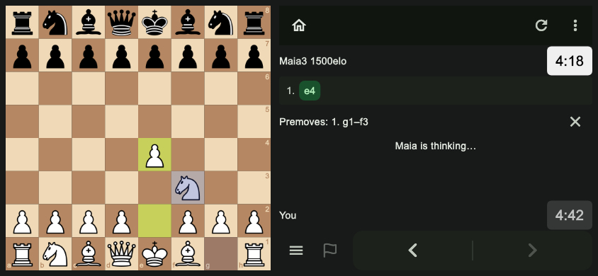
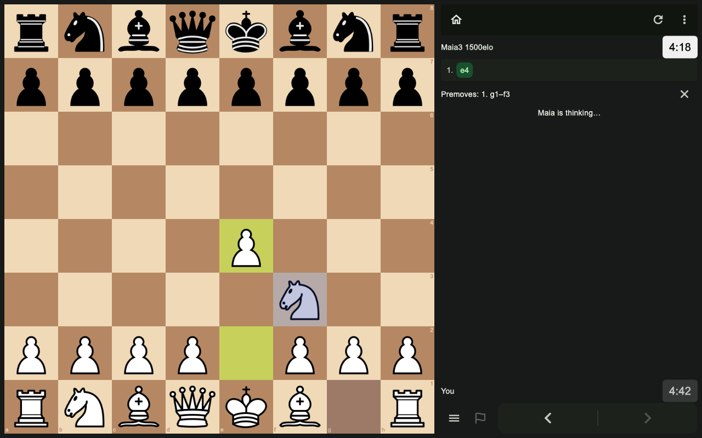
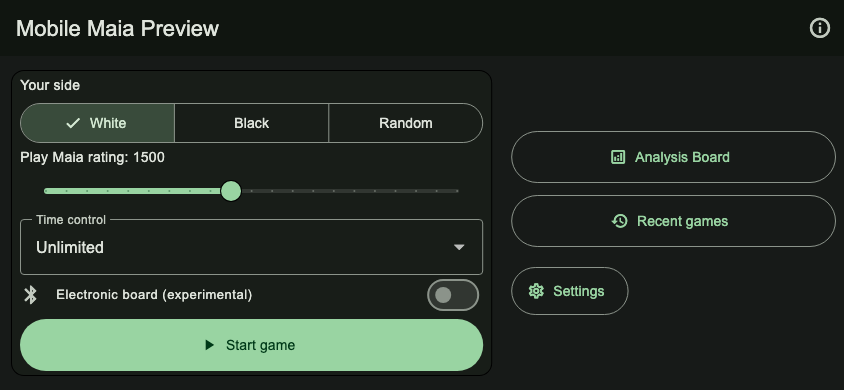
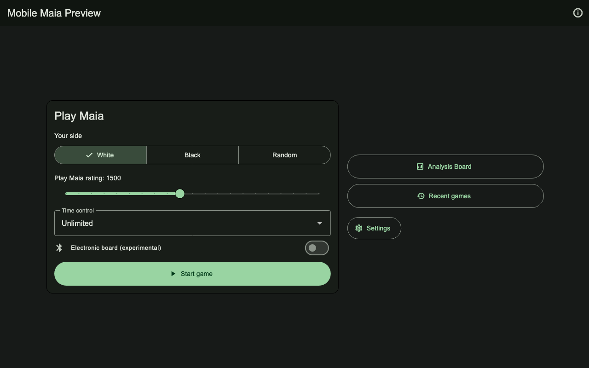
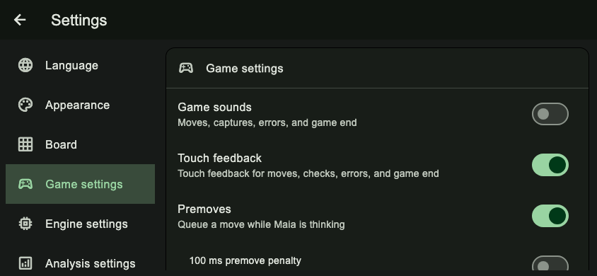
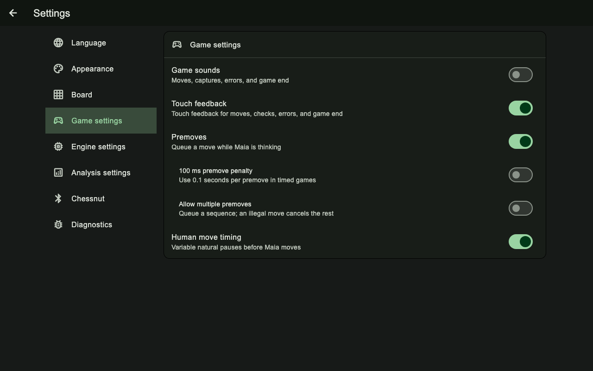
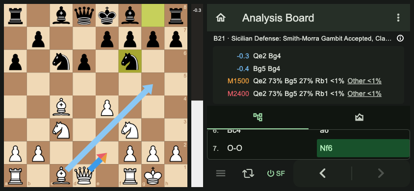
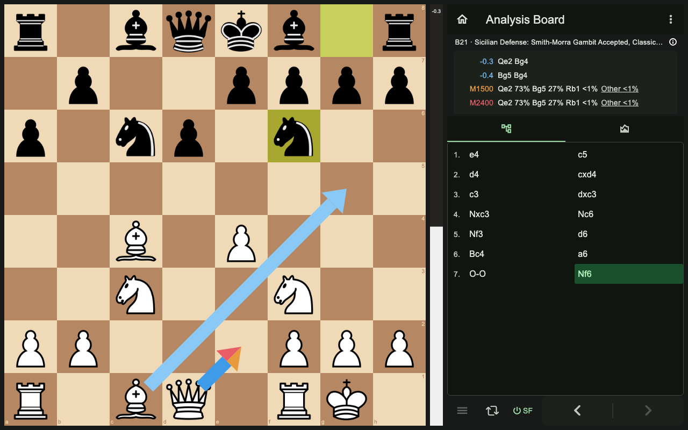
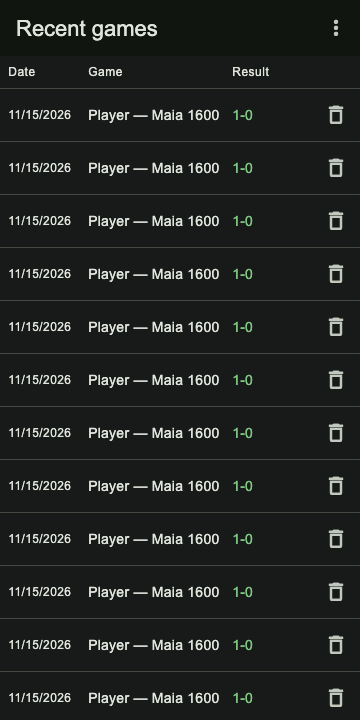

# Adaptive layouts for 2.6

Draft implementation of the layouts reviewed on November 15, 2026, tracked in
[Preview #29](https://github.com/Dash1971/maia-chess-android-preview/issues/29).
This is source work for the 2.6 cycle, not a published build or completed
physical-device acceptance.

Wide gameplay windows put the board on the left and move the existing toolbar,
player information, clocks, history, and controls to the right. The board uses
the available height when the width also leaves a usable side panel. Short
panels scroll independently; reconnect and phone-fallback actions take priority
when a disconnected electronic board needs attention. Narrow landscape windows
that cannot fit both columns scroll a full-size board rather than reducing it
to the former 81-pixel fallback.

Analysis uses the same available-height principle, including the bottom safe
inset, and removes the 560-pixel board cap in wide windows. Its existing engine
lines, Maia probabilities, opening name, moves/graph tabs, evaluation bar, and
navigation remain available. The toolbar moves beside the board; the engine
header can scroll while the moves/graph tabs and move navigation stay visible. Analysis, move
classification, engine inference, and saved-data formats are unchanged.

Home uses a setup column and a second column for Analysis Board, Recent games,
and the content-sized Settings button. Short landscape setup cards reduce
spacing and omit the redundant Play Maia heading; controls retain their touch
targets. An expanded electronic-board setup can still scroll. Portrait Home
keeps its existing arrangement.

Settings uses categories beside the existing settings cards in wide windows.
Language, Appearance, Board, Game settings, Engine settings, Analysis settings,
Chessnut, and Diagnostics retain their actual controls and persistence paths.
Category selection uses a stable icon identity, so changing language does not
switch categories. The diagnostic/reset group contains the existing actions;
the Dev-only diagnostics gate is unchanged. Narrow windows retain the existing
scrolling settings page.

Recent games uses Date, Game, and Result columns with a 52-logical-pixel minimum
row height. Rows can grow for their content. Large text or constrained widths
fall back to the original two-line list. A tap opens the game directly;
long-press selection, checkboxes, individual/bulk deletion, and selected PGN
export retain their existing behavior. Dates still describe the original played
day, and result colors still describe the saved player's outcome. Import and
export limits are unchanged.

## Reviewed designs

The review inputs are retained in the repository so the approved work does not
exist only in chat. These are illustrative HTML fragments for the conversation
viewer, not app screenshots or a second application:

- [Gameplay comparison](design/adaptive-layouts-26/gameplay-comparison.html)
- [Home, Settings, Recent games, and initial Analysis comparison](design/adaptive-layouts-26/screen-comparisons.html)
- [Final Analysis revision: board reaches the bottom inset](design/adaptive-layouts-26/analysis-full-height.html)
- [Compact portrait Recent games](design/adaptive-layouts-26/recent-games-portrait.html)

The final Analysis revision supersedes the board spacing in the earlier
four-screen comparison. Board artwork uses the already bundled Cburnett assets;
the repository's existing third-party notices continue to apply. These files
and the screenshots below are documentation and are not bundled app assets.

## Screens from the implemented widgets

These images come from host-side Flutter widget tests with deterministic game
and engine fixtures. They use the installed system font under the test's Roboto
family alias and the existing icon fonts; no font files are redistributed.
They demonstrate the implemented source, not an Android APK, device performance,
or physical touch comfort.

| Screen | Landscape phone | Tablet |
| --- | --- | --- |
| Gameplay |  |  |
| Home |  |  |
| Settings |  |  |
| Analysis |  |  |

## Validation and remaining acceptance

Host tests exercise full-height phone/tablet boards, controller and queued
premove preservation across rotation, short landscape windows, large text,
actual Home/Settings controls, and compact-table tap/selection behavior. Existing
storage, played-date, result-color, localized-layout, probability, and PGN-export
regressions remain part of verification. Screenshot generation is optional via
`MAIA_LAYOUT_CAPTURES`, using the existing `MAIA_FONT_DIR` fixture convention.

The four new headings have no direct equivalent in the pinned Lichess mobile
catalog. Their native-language fallbacks and context are recorded in
[the terminology notes](LICHESS_TERMINOLOGY.md); the translation review remains
provisional where native review has not occurred.

Before declaring #29 delivered, test an Android build on representative phone,
tablet, and constrained/split-screen emulator configurations; confirm rotation
with active drags and promotion, system insets, gesture navigation, restoration,
and electronic-board states. Confirm comfortable finger input on a physical
phone and seek tablet-tester feedback. This draft does not waive existing
Preview release qualification or hardware acceptance.

No Android builds, Actions, Git LFS/model downloads, version changes, or release
publication are part of this PR. No Stable companion applies: this is a Preview
2.6 product feature, and shared build, CI, verification-tool, and cleanup helpers
are unchanged.
