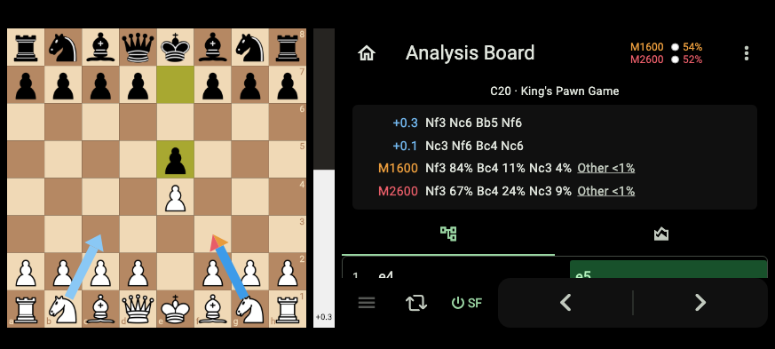
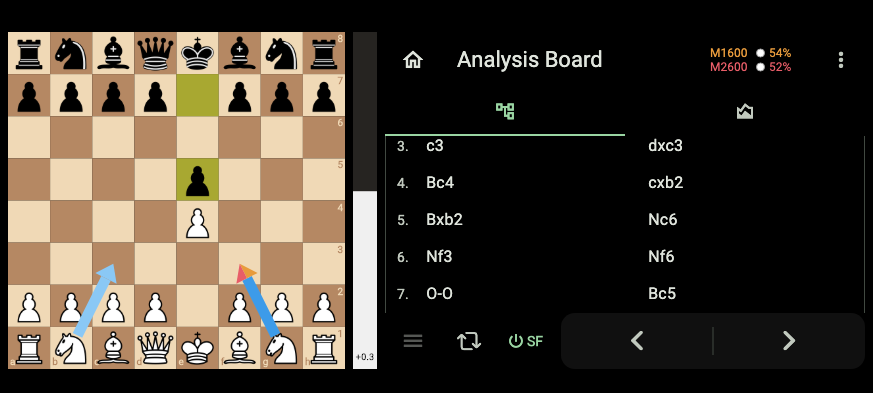

# Continuous landscape analysis scrolling for 2.6

The landscape analysis pane scrolls the opening name, both Stockfish lines,
both enabled Maia probability rows, the tabs, and the active moves or computer
analysis content together. There is one vertical scroll surface, so a downward
drag over the moves can return to the engine output without finding a separate
header strip. There is no automatic collapse or new preference.

The board stays square and uses the available height when the window leaves
enough width for readable analysis. A 4:3 tablet or resized window reserves more
analysis width than the former 260-pixel minimum; the board can exceed the old
Stable 560-pixel cap. The Home/share toolbar remains beside the board. Bottom
navigation stays fixed in normal windows. Exceptionally short windows scroll
the controls into reach rather than overflowing.

Opening a saved position starts at the engine output. Move navigation reveals
the selected move; subsequent rebuilds do not repeatedly scroll back to it.
Moves and computer analysis retain separate scroll positions. Rotation retains
the board/controller and selected position, including portrait move visibility.
Portrait keeps its existing layout.

## Implemented-widget renders

These are Flutter host renders of the implementation with local Roboto and the
bundled board/piece artwork. The position and engine output are deterministic
display fixtures, not new model measurements. Top and bottom system insets are
24 and 16 logical pixels. They are not emulator or physical-device captures.

Phone, 873 × 393 logical pixels, engine output visible:



The same phone after scrolling the pane, with the board position unchanged:



Wide tablet, 1280 × 800:


4:3 tablet, 1024 × 768, with width reserved for the analysis pane:


## Verification and limits

Host verification for this change: 64 focused layout/opening checks with the
local Roboto font, 1,431 full-suite tests passed with four expected skips, and
Flutter analysis reported no issues.

`test/analysis_continuous_scroll_test.dart` exercises landscape viewports of
873 × 393, 1024 × 600, 1280 × 800, 1024 × 768, and 800 × 600 at both normal
and 200% text size. It checks one scroll surface, opening at the top, dragging
through moves and back to the opening, a fixed board/control strip, and no
unintended position changes. Additional cases cover navigation reveal, manual
scroll across rebuilds, tablet portrait/landscape rotation, tab position
restoration, completed computer analysis, 480 × 200 windows, and side cutouts
with a bottom gesture inset. Existing opening tests cover long names and the
full-name dialog.

To reproduce the renders with the repository's pinned Flutter and a local font:

```sh
MAIA_REPORT_FONT=/absolute/path/to/Roboto-Regular.ttf \
MAIA_ANALYSIS_CAPTURES=/absolute/path/to/task-scratch/renders \
flutter test --no-pub test/analysis_continuous_scroll_test.dart
```

Host tests establish layout and Flutter gesture routing at these sizes. Real
tablet touch feel, device-specific system behavior, GPU rendering, and physical
engine/board integration still need device or emulator acceptance. This work
does not build or publish Android packages and does not replace release gates.

## Preview beta.7 Android qualification

[Published beta.7](releases/preview-2.6.0-beta.7.md) delivers #242/#243 and
records actual production-signed ARM64 APK checks for continuous Analysis
scrolling, graph/navigation, tablet/resized/large-text/short-window layouts
and Recent games columns/selection/delete/export flows. Earlier renders remain
host-test illustrations. Physical touch/tablet and actual OS split-screen
acceptance under #29 remain separate; Stable promotion is separate.
