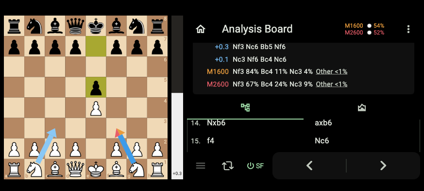
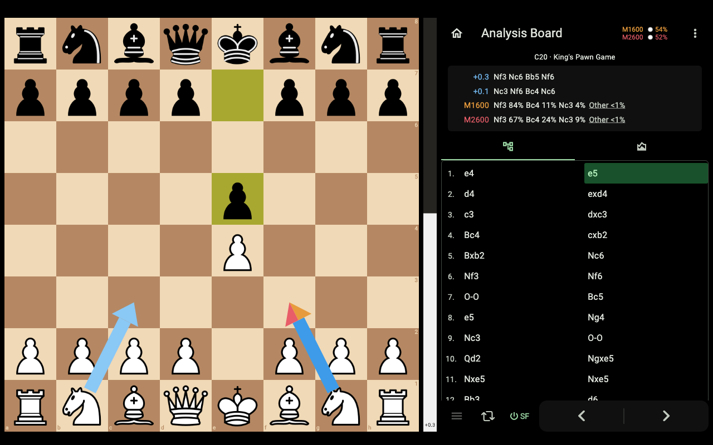
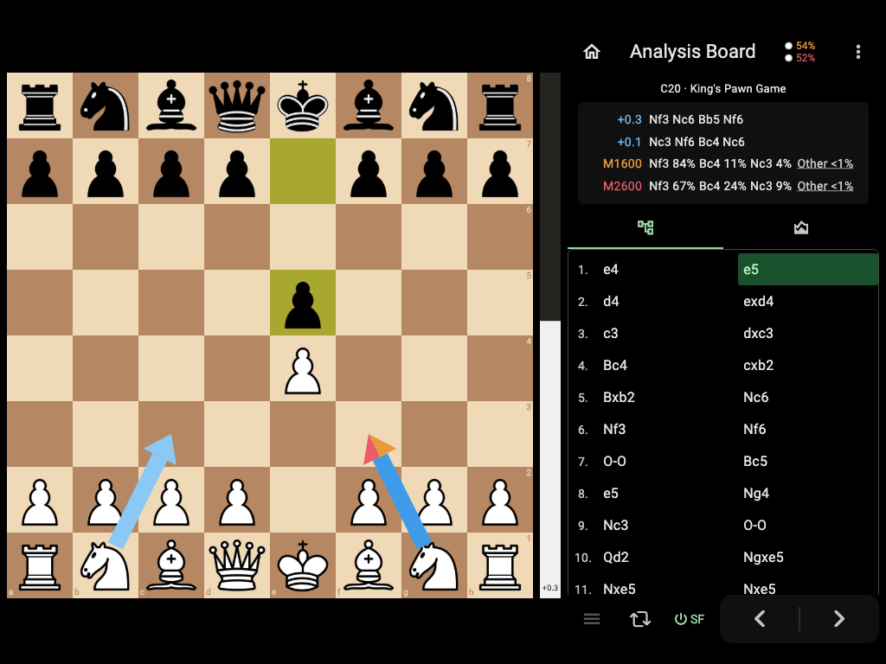

# Coordinated landscape analysis scrolling for 2.6

The landscape analysis pane has a scrollable opening/engine header and an
independently scrollable move window. Swiping upward makes more room for the
moves; swiping downward inside the moves first brings the engine header back,
even when the list is deep in a game. There is no need to find a narrow header
strip to escape the move list. Moves/graph tabs stay reachable above the window.

This uses Flutter's `NestedScrollView` coordinator with `floatHeaderSlivers`.
The body inherits its primary scroll controller; overlap absorption/injection
keeps move rows clear of the pinned tabs. Independent nested controllers caused
the trapped boundary drags in Stable. There are no custom gesture relays,
new dependencies, settings, or persistent navigation history.

Opening a saved position starts at the engine output. Both enabled Maia rows
have their natural height rather than being clipped to make room for the moves.
A landscape phone initially has a small move window that expands on scrolling;
a tablet can show the engine output and several move rows together. Selecting
another move reveals that row without hiding it under the tabs. Engine-output
rebuilds do not repeatedly undo manual scrolling. Moves and computer analysis
retain separate positions. Rotation retains the board/controller and selected
position, including portrait move visibility. Portrait keeps its layout while
reserving enough height for a complete move row at the current text size.

The square board and Home/share toolbar stay fixed. The board uses available
height when enough width remains for readable analysis. Wide tablets can exceed
the old Stable 560-pixel cap; 4:3 tablets and resized windows reserve more analysis
width rather than maximizing the board at its expense. Bottom navigation stays
fixed in normal windows. Exceptionally short windows scroll the tabs and controls
into reach together instead of pinning away the remaining viewport.

## Long-press endpoint navigation

In both portrait and landscape, holding Back returns the board to its starting
position and reveals the first move row. The starting position is before move 1,
so no move is highlighted there. Holding Forward selects and reveals the last
move. Both holds remain available after reaching their destination: scrolling
away and holding again brings the list back without resetting the board or
restarting analysis. Single-step taps remain disabled at their respective ends.
An empty position has no endpoint holds.

Endpoint reveal is requested explicitly rather than depending only on a changed
selection token. Requests made on the computer-analysis tab are retained until
returning to Moves. Side-variation holds keep their existing return-to-main-line
behavior. Portrait reserves a measured, text-scaled move-row height so a selected
row can fit completely at 200% text size.

## Implemented-widget renders

These are Flutter host renders of the implementation with local Roboto and the
bundled artwork. Engine output and the position are deterministic display
fixtures, not model measurements. System insets are 24 pixels above and 16 below.
They are not emulator or physical-device captures.

Phone, 873 × 393 logical pixels, opening and engine output visible:


The same phone after expanding the move window; the board stays fixed:


A reverse drag from deep inside the moves starts restoring the engine output
before the list has returned to its first row:



Wide tablet, 1280 × 800:



4:3 tablet, 1024 × 768:



## Verification and limits

The endpoint follow-up adds eleven regression cases. The full host suite passed
1,451 tests with four skips. All 135 focused navigation/layout/opening checks
passed with local Roboto, all 30 analysis-scroll cases also passed with Flutter's
default test font, and Flutter analysis reported no issues.

`test/analysis_nested_scroll_test.dart` exercises 873 × 393, 1024 × 600,
1280 × 800, 1024 × 768, and 800 × 600 viewports at normal and 200% text size.
It checks coordinated header/list scrolling, reverse drags from deep moves,
short-game boundary drags, fixed board/controls, selected-row reveal in both
directions, manual scrolling across rebuilds, rotation, tab position restoration,
completed computer analysis, very short windows, and side cutouts/gesture insets.
The additional endpoint cases exercise phone and tablet portrait/landscape at
normal and 200% text size without rotation, repeated holds after browsing away,
unchanged board/engine activity at an endpoint, saved games opened at the final
position, editable main lines, graph-tab requests, and empty positions. Existing
opening checks cover long names, the full-name dialog, and navigation.
Score-layout checks retain their geometry assertions even when the move body is
initially offscreen at 200% text size.

To reproduce renders with the pinned Flutter SDK and a local font:

```sh
MAIA_REPORT_FONT=/absolute/path/to/Roboto-Regular.ttf \
MAIA_ANALYSIS_CAPTURES=/absolute/path/to/task-scratch/renders \
flutter test --no-pub test/analysis_nested_scroll_test.dart
```

Host verification establishes layout and Flutter gesture routing at these sizes.
Real tablet touch feel, device-specific system behavior, GPU rendering, and
physical engine/board integration still need device or emulator acceptance.
No Android builds, GitHub Actions, or LFS downloads were used for this follow-up.
This app-only Preview 2.6 layout change reaches Stable through normal promotion;
no shared build, CI, verification, or cleanup helpers are changed.

## Earlier Preview beta.7 qualification

[Published beta.7](releases/preview-2.6.0-beta.7.md) delivered #242/#243 with one
continuous analysis pane and recorded Android qualification for that source.
The coordinated nested scrolling and renders above are a subsequent source
change; beta.7's APK evidence does not qualify it. Physical tablet and actual
OS split-screen acceptance under #29 remain separate, as does Stable promotion.
