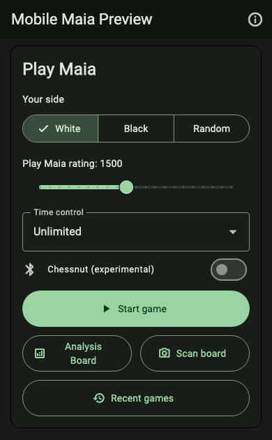
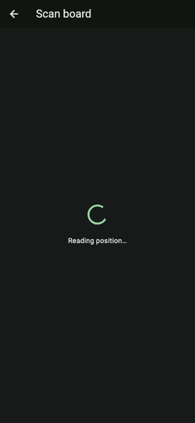
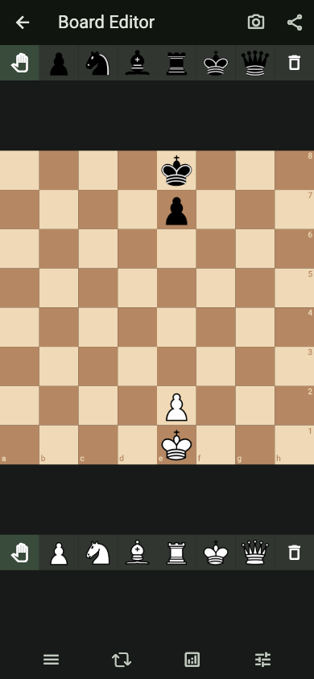
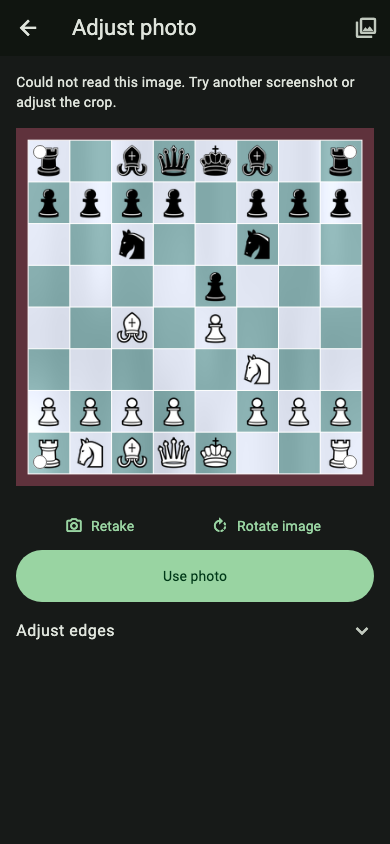

# Camera scan UI: beta.1 gap and follow-up

The approved Home placement and scan-process mockups were not implemented in
#210. This emergency follow-up adds them on top of current main. The earlier icon
and editor simplification were implemented and did reach beta.1.

## What merged on 13 November 2026

| PR | Result |
| --- | --- |
| [#210](https://github.com/Dash1971/maia-chess-android-preview/pull/210) | Image/camera import, Lichess camera icon, no review checkbox or repeated warning paragraphs, same existing Board Editor. Merged head `4837302`, including UI commits `dabc5c9` and `1624983`. |
| [#213](https://github.com/Dash1971/maia-chess-android-preview/pull/213) | Human move timing default on, saved off choice preserved. |
| [#217](https://github.com/Dash1971/maia-chess-android-preview/pull/217) | Hide Maia score percentages when engines are off. |
| [#209](https://github.com/Dash1971/maia-chess-android-preview/pull/209) | Experimental Grand Kingdom and assisted promotion. Known capture failures remain. |
| [#218](https://github.com/Dash1971/maia-chess-android-preview/pull/218) / [#219](https://github.com/Dash1971/maia-chess-android-preview/pull/219) | Preview 2.6.0-beta.1 release and publication record. Qualified source `52378bbc0d038def0678895e4e9e2b3a2d83a08a`. |

| Approved camera UI | Published beta.1 | This follow-up |
| --- | --- | --- |
| Lichess camera icon; remove acknowledgement/tutorial friction | Included | Preserved |
| Return to normal existing Board Editor | Included | Preserved |
| Home Scan board beside Analysis Board | Missing | Implemented; stacks for narrow/large-text layouts |
| Home opens camera directly | Missing | Implemented |
| Read detected grid automatically and open editor | Missing; manual crop/Recognize stage | Implemented |
| Simple framing fallback | Old crop form | Four drag handles, Retake, Rotate image, Use photo; accessible edge sliders under Adjust edges |

## Implemented Flutter screens

These are local host renders of the actual Flutter widgets with existing fonts,
not HTML mockups or APK/device acceptance. The Home image shows the action card.
Camera capture remains the installed Android camera's UI. Recognition output is
controlled in widget tests; the model, recognition quality and native camera
bridge have not changed.

| Home | Reading |
| --- | --- |
|  |  |

| Existing Board Editor | Framing fallback |
| --- | --- |
|  |  |

## Verification and delivery boundary

`test/home_board_scan_test.dart` exercises Home camera launch, automatic recognition,
normal editor/analysis, Continue from here with the scanned FEN, session preservation,
late-result cancellation, missing-camera library fallback, framing controls,
inference retry and all ten languages at 320px/200% text. Existing image/editor,
Home, localization and electronic-board continuation suites remain relevant.

Local verification: 1,410 full-suite tests passed, four expected skips; 120
focused Preview tests; 18 Dev scan tests; Stable/unflavored channel exclusions
passed separately. Static analysis, 480-message × ten catalog checks and the
pinned Lichess terminology check pass. No Android APK was built or published.

No new permission, dependency, network service, model or upload. No native camera,
board adapter, analysis design, version or signing change. This PR publishes no
APK. No Actions or LFS downloads are used. Stable has no image import feature and
needs no companion feature PR; shared build/CI/cleanup helpers are unchanged.
