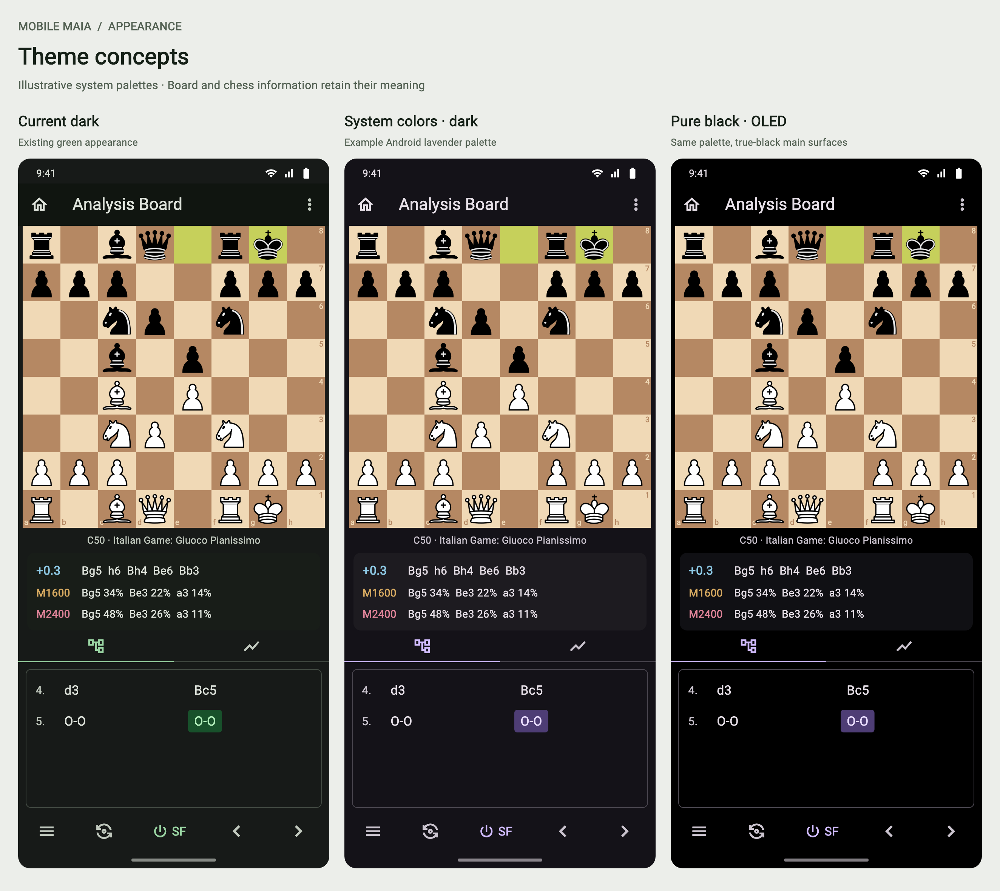
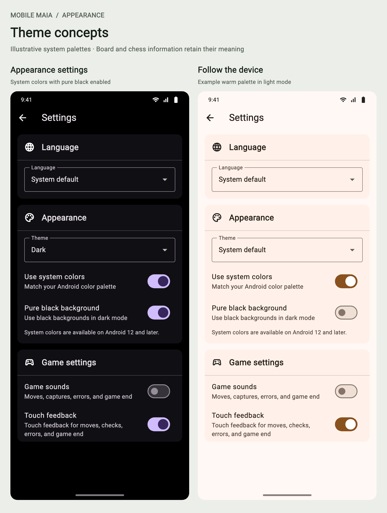

# Optional appearance themes — Preview #124

Draft implementation for Preview. No APK has been built or published for this
change. Android acceptance below remains required before merge/release.

## Choices

Appearance sits immediately below Language. Existing installs and fresh installs
keep the exact existing green-seeded dark Flutter theme (`0xff171a18` background).

- **Theme:** System default / Light / Dark. Default: Dark.
- **Use system colors:** independent of brightness; default off. On Android 12+
  with a supplied palette, uses Android's colors for both light and dark themes.
  Unsupported devices disable the switch, explain why, and use the green fallback.
  A saved preference is retained if the palette is temporarily unavailable.
- **Pure black background:** default off; applies only when the effective theme
  is dark. Main surfaces and the app bar become black. Cards/dialogs retain dark
  surface levels so their boundaries remain visible. The choice is retained while
  displaying light mode, including when following the system.

Changes are immediate and offline. Reset settings to default restores all three
choices. One versioned JSON preference stores only appearance; saved games,
clocks, analysis, engine choices and sampling records are unaffected. Writes are
serialized and failures are shown. Corrupt/unknown preferences use safe defaults.

The existing MaterialApp/Navigator and page state remain in place during changes.
System brightness is handled by MaterialApp; the OS palette is re-read on app
resume and brightness changes, with stale platform replies ignored.

## Scope of color changes

Standard Material surfaces, controls, dialogs and system bars follow the theme.
Board squares, pieces, move highlights and engine arrows retain their existing
colors. Result colors already have light/dark variants. Maia/Stockfish and
classification **text** uses darker versions of the same semantic hues in light
mode; wallpaper colors never redefine their meaning.

The evaluation bar and review graph deliberately retain their black/white chess
scale and self-contained contrasting chart background, in every theme. The live
clocks similarly retain their white/black player distinction. These surfaces are
chess information, not wallpaper-colored decoration. No chess algorithm changes.

## Dependency and licensing review

`dynamic_color` is pinned to **1.9.0**, the upstream line using Flutter's existing
Material library and the already locked `material_color_utilities 0.13.0`.
Version 2.x uses the separate `material_ui` widget library; introducing a second
Material library or migrating this app's UI is outside this change. The lockfile
adds only `dynamic_color`. Apache-2.0; attribution is in THIRD_PARTY_NOTICES and
Flutter's generated package licenses. The plugin reads Android system resources;
no network access, new runtime permissions, analytics or wallpaper images.

The upstream Android plugin uses the Flutter compile SDK and supports minSdk 24;
its AGP/Kotlin integration must be checked in the requested later Android build.
The app's pinned toolchain and release recipe have not been upgraded here.

## Review images

These are design mockups using illustrative palettes, not device certification:

## Before enabling a release

- Run the Flutter analysis, widget/localization and regression checks.
- Build the Android candidate on the documented Linux toolchain.
- On Android 12+, verify actual wallpaper palettes, foreground/background changes,
  light/dark/system choices, OLED, restart, and system-bar contrast.
- On an older/unsupported device verify the green fallback and disabled switch.
- Review Home, Settings, play/clocks, Analysis Board, Recent Games, review graphs,
  result labels, dialogs, diagnostics and large text in both brightness modes.
- Change appearance during an active game/analysis route and confirm navigation,
  position, clocks and analysis state survive. Validate contrast with more than
  one real system palette; mock palettes cannot certify every Android vendor.
