# Sampling defaults and help — 2.5 proposal

Draft only: no merge, Android APK build or publication. The existing green dark
appearance is shown in the screenshots; Appearance PR #156 is a separate change.

## Behavior

- New play/primary analysis rating: 1500; second analysis: 2600, still opt-in.
- New/reset engine defaults: Temperature 1.0, Top-P 0.95, opening variety on.
- Existing explicit preferences are retained. There is no bulk migration, key
  version bump or saved-game rewrite. The legacy MaiaPlaySettings constructor
  and restore fallback deliberately retain their old off behavior.
- Settings reset applies these new engine/analysis values. As before, Home's
  chosen play rating and saved games are outside that Settings reset.
- The first five **full moves for both colors** use 1.0/1.0 when variety is on;
  configured values take over at move 6. FEN numbering governs continuation.
- At Temperature 0, Top-P displays “Not used”, is disabled and has independent
  help. Its saved value is preserved, including across restart. It becomes
  usable again when Temperature rises. No silent 0/0 trap is introduced.
- At full 1/1: a neutral notice mentions unusual blunders.
- Strength notice: **Temperature < 1.0 OR Top-P < 0.95** (below defaults).
  With variety on it says “from move 6”; with variety off it does not.
  Only zero settings add “Good luck!”.
- Repertoire notice: **Temperature < 1.0 OR Top-P < 1.0**, with variety off.
  Both notices appear when both conditions apply. At 1.0 / 0.95, variety on has
  no notice; variety off has only the repertoire notice.
- Explanation selection affects text only, starts on Simple, and is not another
  stored setting. Both levels link to the same visual research guide.
- The sampler, inference calls, analysis percentages and capture format do not change.

## UI previews

Actual Flutter widget renders at 412 × 892 logical pixels, using the current
default dark theme. Desktop rendering fonts differ from Android. No APK build.

| Default settings | Temperature zero |
| --- | --- |
| 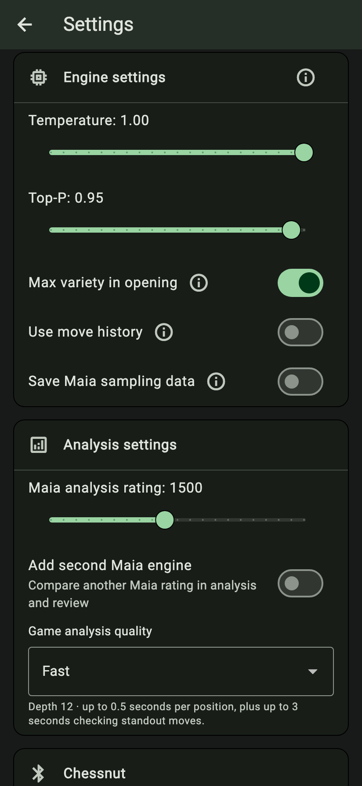 | 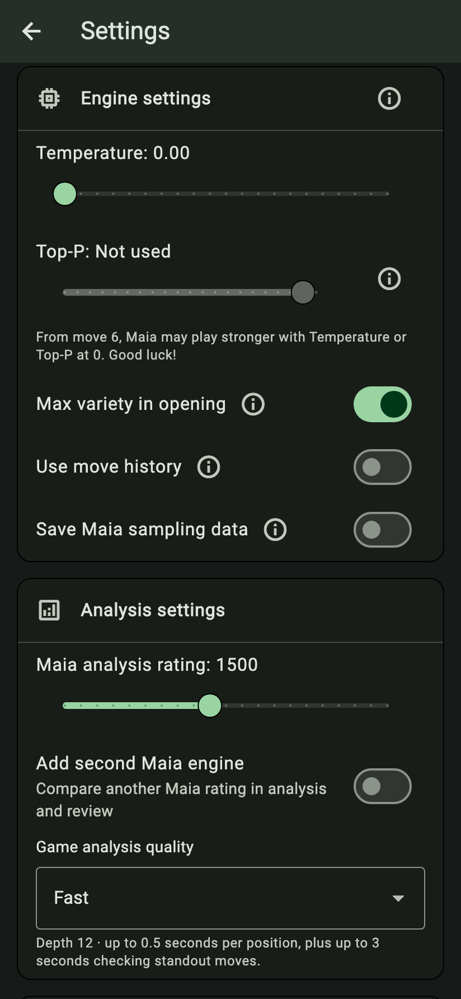 |

| Simple explanation | Technical explanation |
| --- | --- |
| 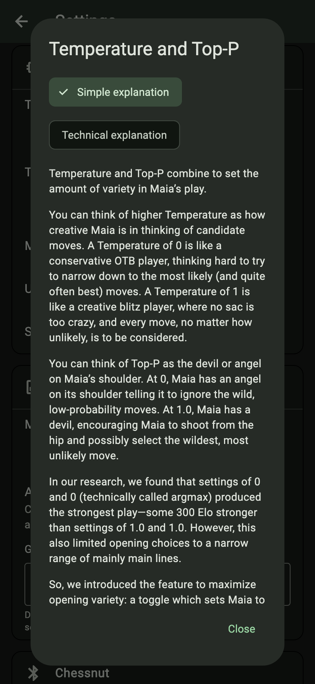 | 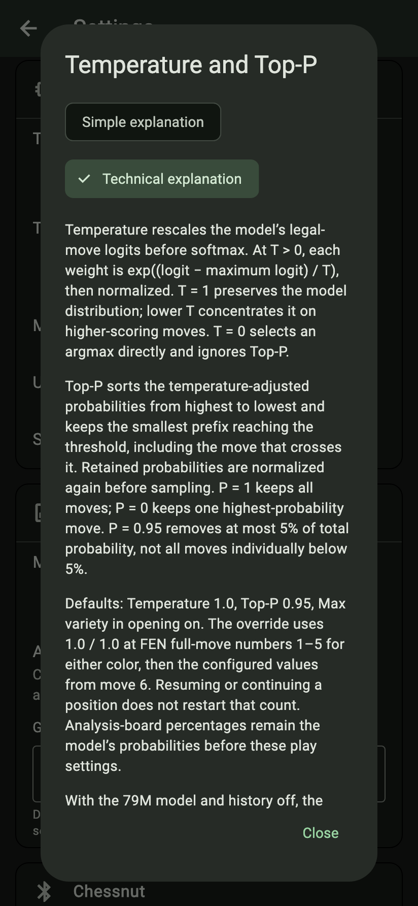 |

[Top-P information dialog](top-p-help.png) · [Opening-variety information](opening-help.png) · [Japanese help](japanese.png)

Long dialogs scroll; their Close action stays available. The source copy below
includes the portions below the screenshot fold.

## Warning-state screenshots

The restricted-opening notice applies when **Temperature < 1.0 OR Top-P < 1.0**,
and opening variety is off. These examples include both controls independently,
all distinct notice combinations, including the strength notice with variety on.
Top-P stays saved but disabled when Temperature is zero.

| Full variety: 1.0 / 1.0 | Top-P 0.95; opening variety off |
| --- | --- |
| 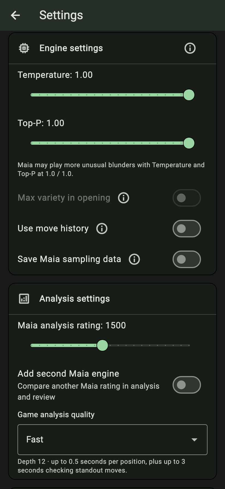 | 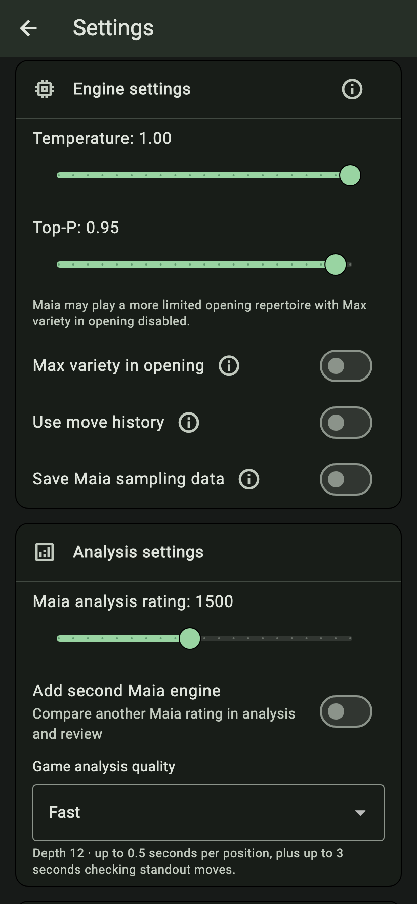 |

| Temperature 0.5 / Top-P 1.0; variety off | Temperature 0; variety on |
| --- | --- |
| 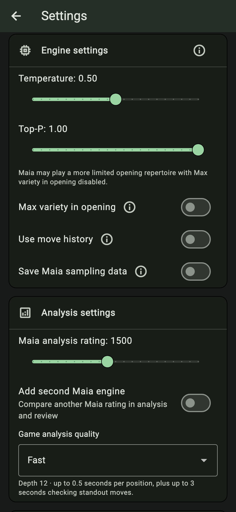 |  |

| Temperature 0; variety off | Top-P 0; variety on |
| --- | --- |
| 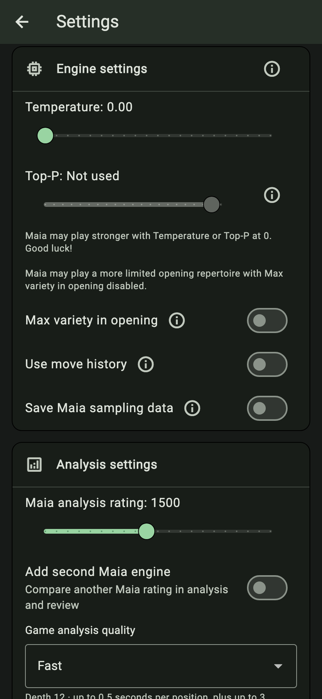 | 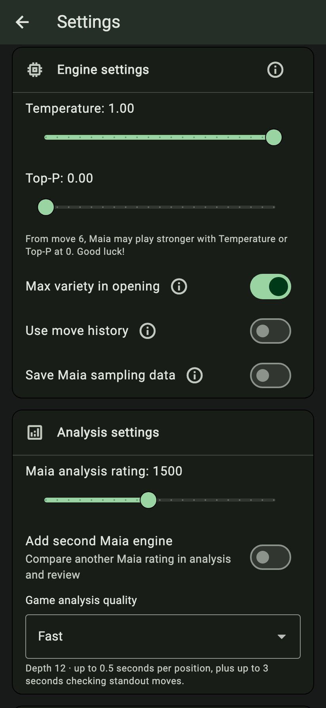 |

| Top-P 0; variety off | Temperature 0.5 / Top-P 0.95; variety on |
| --- | --- |
| 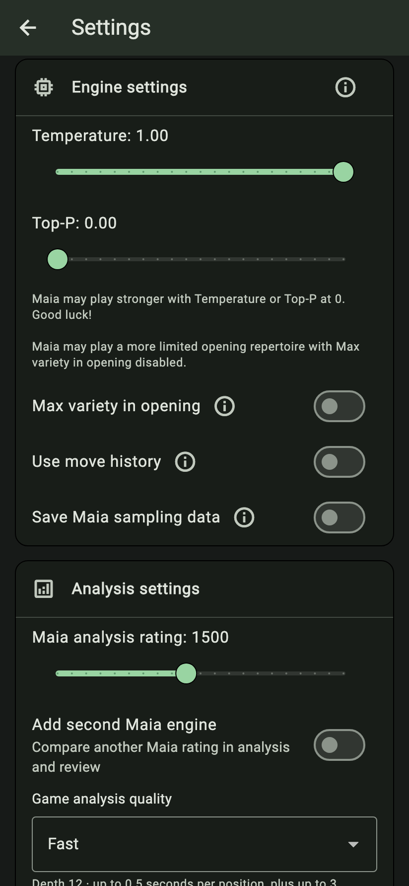 | 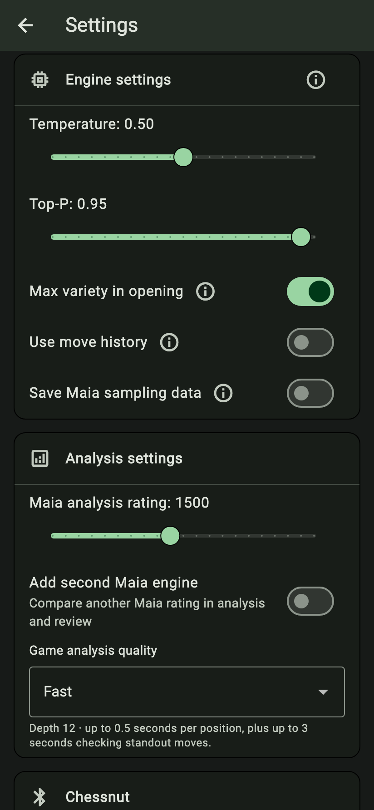 |

The default 1.0 / 0.95 with opening variety on has no notice; see the default
settings screenshot above. At 1.0 / 1.0 the opening toggle is unavailable, so there
is no separate visible on-state for that combination.

## Review copy

### Simple explanation

Temperature and Top-P combine to set the amount of variety in Maia’s play.

You can think of higher Temperature as how creative Maia is in thinking of candidate moves. A Temperature of 0 is like a conservative OTB player, thinking hard to try to narrow down to the most likely (and quite often best) moves. A Temperature of 1 is like a creative blitz player, where no sac is too crazy, and every move, no matter how unlikely, is to be considered.

You can think of Top-P as the devil or angel on Maia’s shoulder. At 0, Maia has an angel on its shoulder telling it to ignore the wild, low-probability moves. At 1.0, Maia has a devil, encouraging Maia to shoot from the hip and possibly select the wildest, most unlikely move.

In our research, we found that settings of 0 and 0 (technically called argmax) produced the strongest play—some 300 Elo stronger than settings of 1.0 and 1.0. However, this also limited opening choices to a narrow range of mainly main lines.

So, we introduced the feature to maximize opening variety: a toggle which sets Maia to play with settings of 1.0 and 1.0 for the first 5 moves. You might see some crazy things in the opening phase! But from the 6th move, Maia switches to your preconfigured settings.

We recommend turning max opening variety on and setting Temperature to 1.0 and Top-P to 0.95. This is like having a creative player with an angel on its shoulder that at least talks it out of playing the totally far-out moves—the least likely moves whose combined probability is up to 5%. These might be brilliant, true, but they can also be silly blunders. So this should make for a good balance of variety in the opening, creativity in the middle game, and stronger play through the exclusion of some very low-probability blunders.

For those feeling brave, setting Temperature to 0 (Top-P doesn’t mean anything when Temperature is 0) will produce the strongest opponent, based on our research. Good luck!

### Technical explanation

Temperature rescales the model’s legal-move logits before softmax. At T > 0, each weight is exp((logit − maximum logit) / T), then normalized. T = 1 preserves the model distribution; lower T concentrates it on higher-scoring moves. T = 0 selects an argmax directly and ignores Top-P.

Top-P sorts the temperature-adjusted probabilities from highest to lowest and keeps the smallest prefix reaching the threshold, including the move that crosses it. Retained probabilities are normalized again before sampling. P = 1 keeps all moves; P = 0 keeps one highest-probability move. P = 0.95 removes at most 5% of total probability, not all moves individually below 5%.

Defaults: Temperature 1.0, Top-P 0.95, Max variety in opening on. The override uses 1.0 / 1.0 at FEN full-move numbers 1–5 for either color, then the configured values from move 6. Resuming or continuing a position does not restart that count. Analysis-board percentages remain the model’s probabilities before these play settings.

With the 79M model and history off, the proposed defaults scored 60.7% against 1.0 / 1.0 in 600 games at rating input 1600 (95% interval 56.8–64.6%). Earlier argmax tests gave a roughly 300-Elo matchup advantage. These are direct-match results, not calibrated human ratings. Five moves is a design choice, not a proven optimum; probability filtering cannot guarantee good moves.

### Opening variety

On by default. Uses Temperature and Top-P 1.0 / 1.0 for the first five moves by each side, then your configured settings from move 6. This keeps broad opening choices while allowing you to trim low-probability moves later. It follows the position’s move number, including when resuming or continuing a game.

Not needed at 1.0 / 1.0: the switch is off and unavailable because those settings already give full variety throughout.

### Top-P at Temperature zero

At Temperature 0, Maia always chooses a most likely move, so Top-P has no effect. Your Top-P value is kept and becomes available again when you raise Temperature. If Max variety in opening is on, the first five moves by each side still use 1.0 / 1.0.

## Research companion and release order

[Research companion PR #3](https://github.com/Dash1971/mobile-maia-research/pull/3) adds the guide in the dedicated research repository at
`guides/choosing-maia-settings/README.md`. Merge that companion first and verify
its public main-branch URL before merging/releasing this app change. Existing
research links and archived study evidence are retained.

A merge dry run with PR #156 found conflicts in localization catalogs, generated
localizations and terminology/review documentation, but no Dart application-code
conflicts. Reconcile both sets of source strings, regenerate localizations, and
rerun localization, host regressions and Android qualification on the actual
combined source before publishing Preview. This PR does not merge
that appearance dependency or qualify it for Android/F-Droid.

## Verification

Host regression coverage includes new/reset defaults, explicit preference
preservation, malformed preference fallback, first-five-move boundaries for both
colors, restored profiles, capture probabilities, takebacks, board reset and
continued games. Nineteen explicit notice scenarios cover the recommendation
boundaries, deterministic settings and both opening states. All ten languages exercise Simple/Technical selection,
research navigation, dismissal and Top-P inactive help at 320px and 200% text.
Screenshots come from Flutter widget rendering, not an installed Android APK.
Android/device checks remain a later publication gate.

Earlier full-suite qualification: **1,084 passed, 3 skipped**. Latest revision:
**165 focused tests passed**, including both notices together in all ten
languages at 320px/200% text, fresh/reset default no-notice checks, and separate
strength/repertoire boundaries. Static analysis and localization/reference
checks passed (401 messages per catalog).

The strength threshold follows the default constants (Temperature 1.0 / Top-P
0.95). The repertoire threshold is independently 1.0 / 1.0, with opening
variety off. Nonzero values use the neutral strength notices; zero values keep
“Good luck!” and never duplicate the neutral strength notice. The approved
Simple explanation is unchanged verbatim. Current screenshots include the
no-notice default and repertoire-only 1.0 / 0.95 cases. No APK build, merge or
publication.
